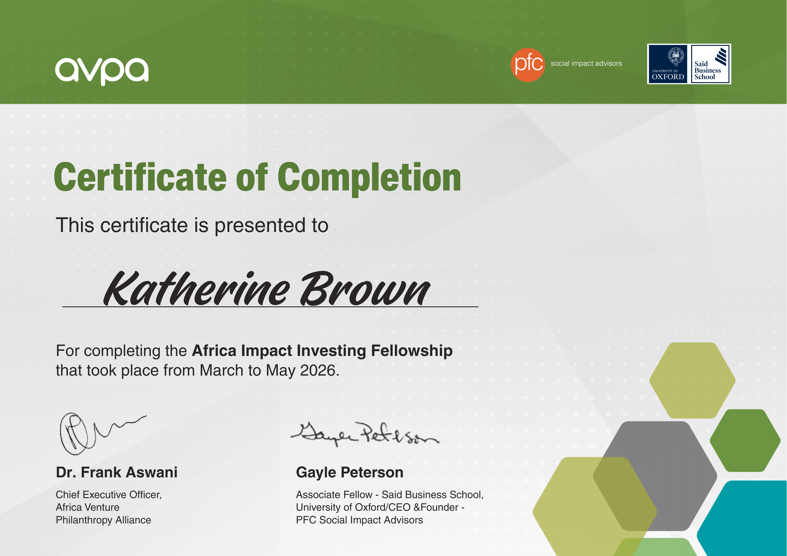
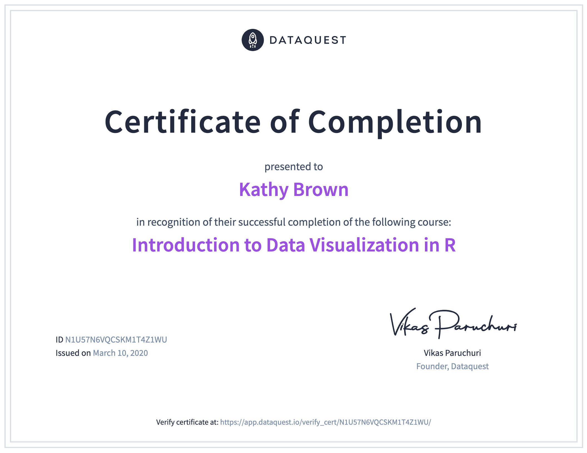

I'm always keen to learn new skills. Here are the certifications I've earned most recently.

## Africa Impact Investing Fellowship

::: {.grid .cert-card}

::: {.g-col-12 .g-col-md-5}
{fig-alt="Africa Impact Investing Fellowship certificate awarded to Katherine Brown"}
:::

::: {.g-col-12 .g-col-md-7}
[Saïd Business School, University of Oxford & African Venture Philanthropy Alliance]{.cert-issuer}

[Completed May 2026]{.cert-date}

This course focused on hands-on experiential learning, including investment opportunity analysis, deal structuring, cost-effectiveness modelling and impact measurement; investment committee simulation with an international cohort of 38 Fellows collectively managing over USD 2 billion in assets. 

[About the fellowship](https://knowledge.avpa.africa/courses/africa-impact-investing-fellowship-aiif/){.cert-button}
:::

:::

## Data Visualization in R

::: {.grid .cert-card}

::: {.g-col-12 .g-col-md-5}
{fig-alt="Dataquest Data Visualization in R certificate awarded to Katherine Brown"}
:::

::: {.g-col-12 .g-col-md-7}
[Dataquest]{.cert-issuer}

[Completed March 2020]{.cert-date}

This course focused on effective data visualisation techniques in R, including cleaning data, building charts, creating infographics and more. 

[Verify on Dataquest](https://app.dataquest.io/view_cert/N1U57N6VQCSKM1T4Z1WU/){.cert-button}
:::

:::

